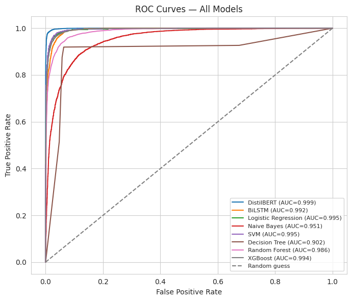
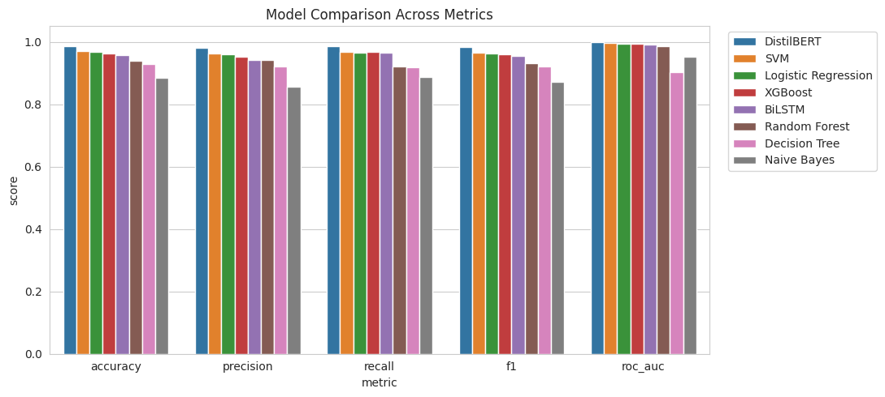
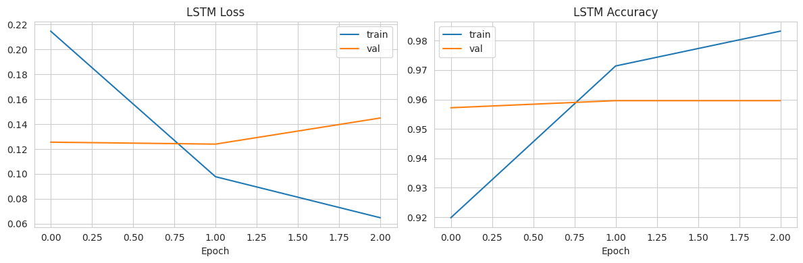
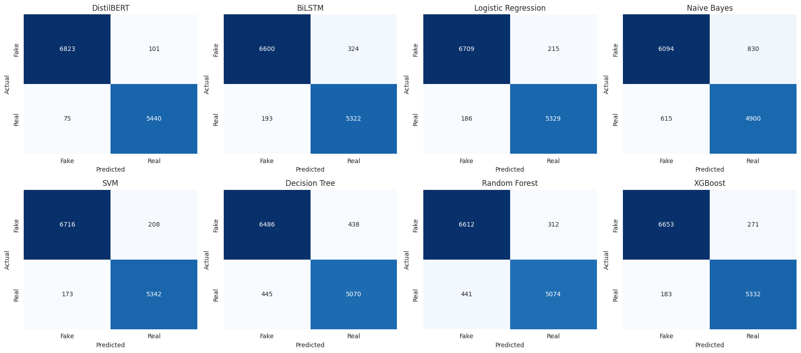

# 📰 Fake News Detection: From TF-IDF Baselines to Fine-Tuned DistilBERT


A complete NLP benchmark on the **WELFake** corpus (72k news articles). It compares **eight classifiers** across four model families on the same stratified split: probabilistic, linear, tree ensembles, a recurrent network, and a transformer. A fine-tuned **DistilBERT reaches 98.6% accuracy and 0.999 ROC-AUC**.

<p align="center">
  
</p>

## 📊 Results

Held-out test set: **12,439 articles** (a stratified 20% split after de-duplication).

| # | Model | Family | Accuracy | Precision | Recall | F1 | ROC-AUC | Train Time |
|---|---|---|---:|---:|---:|---:|---:|---:|
| 🥇 | **DistilBERT** (fine-tuned, 2 epochs) | Transformer | **0.9859** | **0.9818** | **0.9864** | **0.9841** | **0.9992** | 14.7 min (GPU) |
| 🥈 | Linear SVM (tuned C) | Linear | 0.9694 | 0.9625 | 0.9686 | 0.9656 | 0.9952 | **1.1 s** |
| 🥉 | Logistic Regression (tuned C) | Linear | 0.9678 | 0.9612 | 0.9663 | 0.9637 | 0.9946 | 1.8 s |
| 4 | XGBoost | Boosting | 0.9635 | 0.9516 | 0.9668 | 0.9592 | 0.9943 | 16.4 min |
| 5 | BiLSTM (2.67M params) | Deep learning | 0.9584 | 0.9426 | 0.9650 | 0.9537 | 0.9924 | 35.8 min |
| 6 | Random Forest | Bagging | 0.9395 | 0.9421 | 0.9200 | 0.9309 | 0.9859 | 4.8 min |
| 7 | Decision Tree | Tree | 0.9290 | 0.9205 | 0.9193 | 0.9199 | 0.9020 | 2.7 min |
| 8 | Multinomial Naive Bayes | Probabilistic | 0.8838 | 0.8551 | 0.8885 | 0.8715 | 0.9514 | 0.1 s |

*Precision and recall are for the positive class (label 1, which is fake news; see the label audit below).*

**Key takeaways**
- **DistilBERT is the clear winner.** It cuts the error rate by more than half compared with the best classical model (1.4% vs. 3.1%).
- **A tuned linear SVM on TF-IDF bigrams gets within 1.7 points of DistilBERT in about 1 second on a CPU.** That trade-off matters when you deploy.
- The **BiLSTM underperforms the linear baselines** while taking over 1,000× longer to train. Without pre-trained knowledge, sequence models gain little over strong n-gram features on this corpus.
- Single trees overfit TF-IDF space badly (AUC 0.90). Boosting fixes most of that.

## 🔍 Label Audit: a Data-Quality Finding

The Kaggle dataset page says `0 = fake, 1 = real`. **The data says the opposite:**

| Label | Articles | Contain the `(Reuters)` wire tag | Contain `Featured image` (a fake-site marker) |
|---|---:|---:|---:|
| 0 | 35,028 | **60.7%** | 0.0% |
| 1 | 37,106 | 0.0% | **20.0%** |

The model independently confirms this: `reuters` is the strongest label-0 feature in the Logistic Regression coefficients. Accuracy, F1, and AUC are unaffected. However, the "Fake" and "Real" captions on the EDA plots in the notebook come from the Kaggle naming and should be read swapped, so the notebook carries a note explaining this.

This also shows a **dataset shortcut**: source-specific artefacts like `(Reuters)`, `Featured image`, and `pic twitter` are highly predictive. Part of every model's accuracy therefore comes from *where* an article was published rather than *what* it claims. This is a known limitation of WELFake-style corpora, and the obvious next step would be to evaluate on sources the models haven't seen.

## 🔬 Pipeline

```
WELFake (72,134) ─► Clean: drop NaN, duplicate texts, empty rows ─► 62,192 articles
                 ─► title + text ─► lowercase · strip URLs/HTML/punctuation/digits · stopwords · lemmatise
                 ─► Stratified 80/20 split (seed 42)
                 ├─► TF-IDF (1–2-grams, 60k features, sublinear tf; fitted on train only)
                 │     ├─ LogReg / Linear SVM (GridSearchCV over C, 3-fold, F1) · Naive Bayes
                 │     └─ Decision Tree · Random Forest (200 trees) · XGBoost (250 rounds)
                 ├─► Keras tokenizer (20k vocab, length 300) ─► Embedding(128) ─► BiLSTM(64) ─► Dense ─► sigmoid
                 └─► DistilBERT tokenizer (length 300) ─► distilbert-base-uncased fine-tuned 2 epochs, lr 2e-5, fp16
```

**EDA included:** class balance, length distributions, word clouds, top bigrams per class, stylistic features (exclamation and question marks, ALL-CAPS ratio, average word length), and feature–label correlations.

## 📈 Visualisations

| Metric comparison | BiLSTM training |
|---|---|
|  |  |


*Confusion matrices. Axis captions follow the Kaggle naming, so read "Fake" as label 0 (actually Real) and "Real" as label 1 (actually Fake).*

## 🚀 Run It

The notebook was developed on **Google Colab with a GPU**, which DistilBERT fine-tuning needs. It downloads the dataset automatically with `kagglehub`.

[](https://colab.research.google.com/github/nabilah-hossain-ruba/fake-news-detection/blob/main/fake_news_detection.ipynb)

To run it locally:

```bash
git clone https://github.com/nabilah-hossain-ruba/fake-news-detection.git
cd fake-news-detection
pip install -r requirements.txt
jupyter notebook fake_news_detection.ipynb
```

## 🗂️ Project Structure

```
├── fake_news_detection.ipynb   # EDA → preprocessing → 8 models → comparison
├── images/                     # Figures exported from the notebook
└── requirements.txt
```

The dataset (245 MB) isn't committed. Get it from [Kaggle: WELFake](https://www.kaggle.com/datasets/saurabhshahane/fake-news-classification).

## 📚 References

1. P. K. Verma et al., "WELFake: Word Embedding Over Linguistic Features for Fake News Detection," *IEEE Trans. Computational Social Systems*, 2021.
2. R. K. Kaliyar, A. Goswami, P. Narang, "FakeBERT: Fake news detection in social media with a BERT-based deep learning approach," *Multimedia Tools and Applications*, 2021.
3. I. Ahmad et al., "Fake News Detection Using Machine Learning Ensemble Methods," *Complexity*, 2020.
4. W. Y. Wang, "'Liar, Liar Pants on Fire': A New Benchmark Dataset for Fake News Detection," *ACL*, 2017.
5. N. Ruchansky, S. Seo, Y. Liu, "CSI: A Hybrid Deep Model for Fake News Detection," *CIKM*, 2017.
6. Y. Wang et al., "EANN: Event Adversarial Neural Networks for Multi-Modal Fake News Detection," *KDD*, 2018.
7. V.-H. Nguyen et al., "FANG: Leveraging Social Context for Fake News Detection Using Graph Representation," *CIKM*, 2020.
8. K. Nakamura, S. Levy, W. Y. Wang, "r/Fakeddit: A New Multimodal Benchmark Dataset for Fine-grained Fake News Detection," *LREC*, 2020.
9. J. Su et al., "Fake News Detectors are Biased against Texts Generated by Large Language Models," arXiv:2309.08674, 2023.

---

*Course project for CSE427 at BRAC University.*
